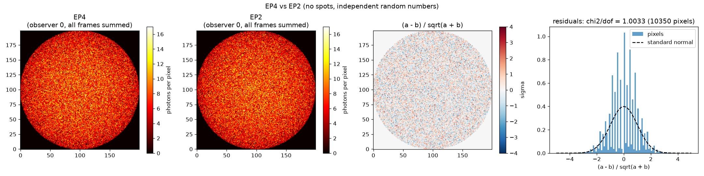

# Checks: ep2-cpu64

2026-11-22T11:29:37 · Intel(R) Core(TM) Ultra 7 255HX (one core) · code `72b86b63cbf7` · passed

**χ²/dof = 1.0033: the same physics within noise**

`python main.py check all -n 1e7`

## What was asked

| option | value |
|---|---|
| photons | 10000000 |
| seed | 42 |
| limb | 1.0 |
| spots | 3 |
| observers | [1.5708, 1.0472, 0.5236, 0.0] |
| size | 200 |
| frames | 150 |
| chunk_size | 1024 |
| check | ep2 |
| processor | cpu |
| precision | 64 |

## Results

Without spots, independent random numbers, frames summed.

N = 1e+07, 200² pixels, 150 frames, nmu = 47, observers at 2.93494, 1.91817, 1.26833, 0.206652 rad, 0 spots

| run | photons/s | photons (s) | setup (s) | zero (s) | copy (s) | save (s) | passes | recorded | blocked |
|---|---|---|---|---|---|---|---|---|---|
| EP4 | 7.99e+06 | 1.251 | 0.043 | 0.007 | 0.000 | 0.138 | 1 | 852159 (8.52%) | 0 |

- EP2: 1e+07 photons in 1.843 s (5.43e+06 photons/s, its setup and save included)
- χ²/dof = 1.0033 over 10350 pixels (+0.24 σ from 1)

| observer | EP4 | EP2 | difference (σ) |
|---|---|---|---|
| 0 | 213176 | 212651 | +0.80 |
| 1 | 212897 | 212701 | +0.30 |
| 2 | 212711 | 213273 | -0.86 |
| 3 | 213375 | 213133 | +0.37 |

## Figures

## Files

- [`comparison.png`](comparison.png)
- [`run.json`](run.json)
