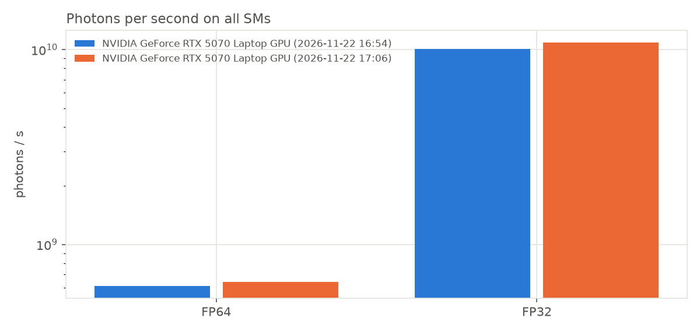
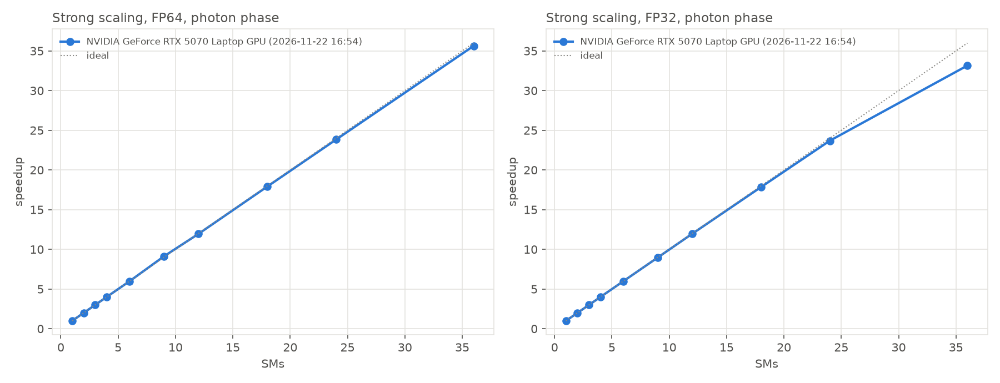
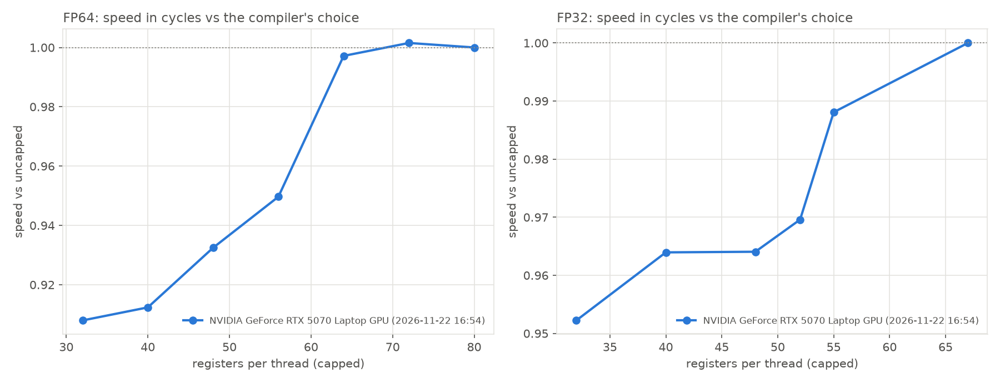

# Compare: Welton-vs-Welton

2026-11-22T17:07:54 · Welton · code `72b86b63cbf7` · done

**NVIDIA GeForce RTX 5070 Laptop GPU (2026-11-22 16:54) vs NVIDIA GeForce RTX 5070 Laptop GPU (2026-11-22 17:06): see the report**

`python main.py compare runs/measure/2026-11-22_16-54-40-Welton-all runs/measure/2026-11-22_17-06-33-Welton-validation-devices-kernel`

## What was asked

| option | value |
|---|---|
| measurements | ['measure/2026-11-22_16-54-40-Welton-all', 'measure/2026-11-22_17-06-33-Welton-validation-devices-kernel'] |

## Results

**The report:** [report.pdf](report.pdf), [report.ipynb](report.ipynb)

- NVIDIA GeForce RTX 5070 Laptop GPU (2026-11-22 16:54): `measure/2026-11-22_16-54-40-Welton-all`
- NVIDIA GeForce RTX 5070 Laptop GPU (2026-11-22 17:06): `measure/2026-11-22_17-06-33-Welton-validation-devices-kernel`

## Figures

## Files

- [`figures/`](figures/)
- [`parts/`](parts/)
- [`report.ipynb`](report.ipynb)
- [`report.pdf`](report.pdf)
- [`run.json`](run.json)
