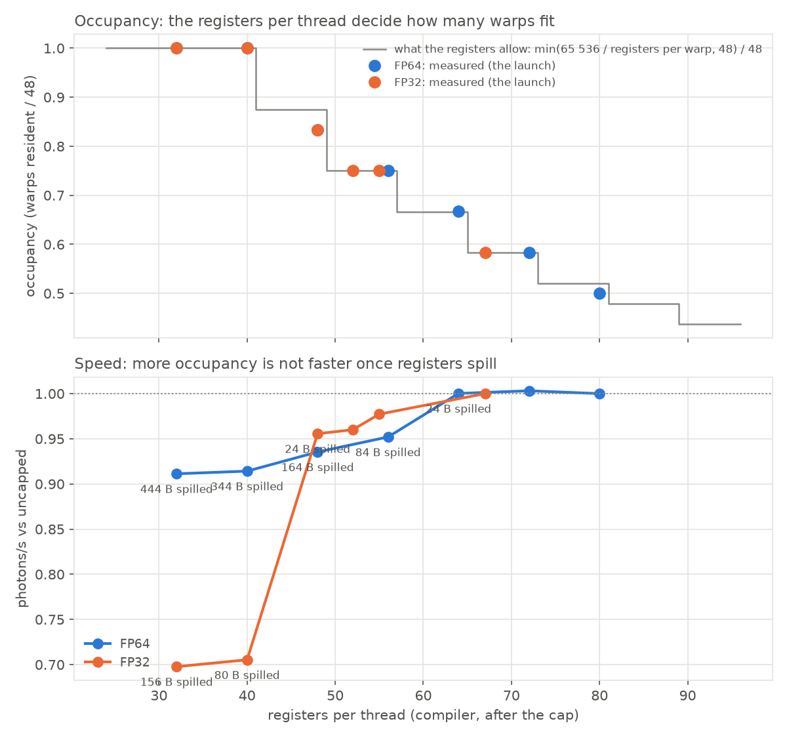

# Kernel: registers-sweep

2026-11-22T12:02:39 · NVIDIA GeForce RTX 5070 Laptop GPU (cc 12.0, 36 SMs) · code `72b86b63cbf7` · done

**FP64: fastest at 72 registers (occupancy 0.58); occupancy 1.00 at 40 registers is 9% slower (344 B spilled); FP32: fastest at 67 registers (occupancy 0.58); occupancy 1.00 at 40 registers is 29% slower (80 B spilled)**

`python main.py (scratch) registers sweep`

## What was asked

| option | value |
|---|---|
| caps | {64: ['none', 72, 64, 56, 48, 40, 32], 32: ['none', 64, 56, 48, 40, 32]} |
| photons | {64: 1000000000, 32: 10000000000} |
| repeats | 3 |
| sm_limits | {'NAME': 'NVIDIA GeForce RTX 5070 Laptop GPU', 'COMPUTE_CAPABILITY': '12.0', 'SMS': '36', 'REGISTERS_PER_SM': '65536', 'REGISTERS_PER_BLOCK': '65536', 'MAX_THREADS_PER_SM': '1536', 'MAX_THREADS_PER_BLOCK': '1024', 'MAX_BLOCKS_PER_SM': '24', 'WARP_SIZE': '32', 'SHARED_MEMORY_PER_SM': '102400'} |
| register_allocation_per_thread | 8 |

## Results

The SM: 65536 registers, at most 48 warps (1536 threads) and 24 blocks (cudaGetDeviceProperties). Registers are allocated in steps of 8 per thread, so per warp = ⌈r/8⌉·8·32. The launch is the occupancy API's choice for each build.

### FP64, N = 1e+09, 3 repeats

| cap | registers | per warp | warps the registers allow | block | blocks/SM | occupancy | limited by | spills (B) | kernel (s) | photons/s | vs uncapped | clock (MHz) | power (W) | image = uncapped |
|---|---|---|---|---|---|---|---|---|---|---|---|---|---|---|
| none | 80 | 2560 | 25 | 768 | 1 | 0.50 | registers | 0 | 1.544 (±0.1%) | 6.48e+08 | 1.000× | 2880 | 50 | yes |
| 72 | 72 | 2304 | 28 | 896 | 1 | 0.58 | registers | 0 | 1.539 (±0.0%) | 6.5e+08 | 1.003× | 2880 | 44 | yes |
| 64 | 64 | 2048 | 32 | 1024 | 1 | 0.67 | registers | 24 | 1.543 (±0.0%) | 6.48e+08 | 1.000× | 2880 | 45 | yes |
| 56 | 56 | 1792 | 36 | 576 | 2 | 0.75 | registers | 84 | 1.622 (±0.1%) | 6.17e+08 | 0.952× | 2880 | 44 | yes |
| 48 | 48 | 1536 | 42 | 640 | 2 | 0.83 | registers | 164 | 1.650 (±0.0%) | 6.06e+08 | 0.935× | 2880 | 46 | yes |
| 40 | 40 | 1280 | 51 | 768 | 2 | 1.00 | threads (the SM is full) | 344 | 1.689 (±0.1%) | 5.92e+08 | 0.914× | 2880 | 48 | yes |
| 32 | 32 | 1024 | 64 | 768 | 2 | 1.00 | threads (the SM is full) | 444 | 1.694 (±0.0%) | 5.9e+08 | 0.911× | 2880 | 50 | yes |

### FP32, N = 1e+10, 3 repeats

| cap | registers | per warp | warps the registers allow | block | blocks/SM | occupancy | limited by | spills (B) | kernel (s) | photons/s | vs uncapped | clock (MHz) | power (W) | image = uncapped |
|---|---|---|---|---|---|---|---|---|---|---|---|---|---|---|
| none | 67 | 2304 | 28 | 896 | 1 | 0.58 | registers | 0 | 0.908 (±0.1%) | 1.1e+10 | 1.000× | 2748 | 90 | yes |
| 64 | 55 | 1792 | 36 | 576 | 2 | 0.75 | registers | 0 | 0.929 (±0.1%) | 1.08e+10 | 0.977× | 2550 | 91 | yes |
| 56 | 52 | 1792 | 36 | 576 | 2 | 0.75 | registers | 0 | 0.945 (±0.2%) | 1.06e+10 | 0.960× | 2414 | 88 | yes |
| 48 | 48 | 1536 | 42 | 640 | 2 | 0.83 | registers | 24 | 0.950 (±14.2%) | 1.05e+10 | 0.956× | 2032 | 64 | yes |
| 40 | 40 | 1280 | 51 | 768 | 2 | 1.00 | threads (the SM is full) | 80 | 1.287 (±0.0%) | 7.77e+09 | 0.705× | 2017 | 52 | yes |
| 32 | 32 | 1024 | 64 | 768 | 2 | 1.00 | threads (the SM is full) | 156 | 1.301 (±0.1%) | 7.69e+09 | 0.698× | 2017 | 56 | yes |

## Figures

## Files

- [`registers_and_occupancy.png`](registers_and_occupancy.png)
- [`registers_sweep.json`](registers_sweep.json)
- [`run.json`](run.json)
