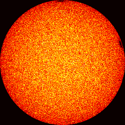
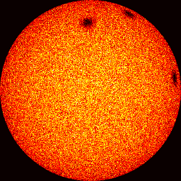
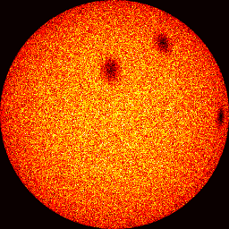
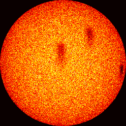

# Make: 256-f60-gpu32-snr3

2026-11-22T17:08:18 · NVIDIA GeForce RTX 5070 Laptop GPU (cc 12.0, 36 SMs) · code `72b86b63cbf7` · done

**N = 8.80e+08 photons in 0 s (9.4e+09 photons/s); SNR center 4.2 (predicted 4.2), limb 3.5 (predicted 3.5)**

`python main.py make --size 256 --frames 60 --snr 3 --yes`

## What was asked

| option | value |
|---|---|
| photons | 880168705 |
| seed | 42 |
| limb | 1.0 |
| spots | 3 |
| observers | [1.5708, 1.0472, 0.5236, 0.0] |
| size | 256 |
| frames | 60 |
| chunk_size | 1024 |
| processor | gpu |
| precision | 32 |
| snr_at_the_limb | 3.0 |

## Results

N = 8.8e+08, 256² pixels, 60 frames, nmu = odd nearest frames/π, observers at 1.5708, 1.0472, 0.5236, 0 rad, 3 spots

| run | photons/s | photons (s) | setup (s) | zero (s) | copy (s) | save (s) | passes | recorded | blocked |
|---|---|---|---|---|---|---|---|---|---|
| gpu32 | 9.37e+09 | 0.094 | 0.144 | 0.000 | 0.005 | 0.141 | 1 | 183745736 (20.88%) | 3630022 |

| observer | video | SNR center: measured / predicted | SNR limb ring: measured / predicted |
|---|---|---|---|
| observer_mu0009_i1.5708 | [observer_mu0009_i1.5708.mp4](observer_mu0009_i1.5708.mp4) | 4.2 / 4.2 | 3.5 / 3.5 |
| observer_mu0014_i1.0165 | [observer_mu0014_i1.0165.mp4](observer_mu0014_i1.0165.mp4) | 4.2 / 4.2 | 3.5 / 3.5 |
| observer_mu0017_i0.5696 | [observer_mu0017_i0.5696.mp4](observer_mu0017_i0.5696.mp4) | 4.2 / 4.2 | 3.5 / 3.5 |
| observer_mu0018_i0.3259 | [observer_mu0018_i0.3259.mp4](observer_mu0018_i0.3259.mp4) | 4.2 / 4.2 | 3.5 / 3.5 |

## Figures

## Files

- [`make.json`](make.json)
- [`observer_mu0009_i1.5708.mp4`](observer_mu0009_i1.5708.mp4)
- [`observer_mu0009_i1.5708_frame_0.png`](observer_mu0009_i1.5708_frame_0.png)
- [`observer_mu0014_i1.0165.mp4`](observer_mu0014_i1.0165.mp4)
- [`observer_mu0014_i1.0165_frame_0.png`](observer_mu0014_i1.0165_frame_0.png)
- [`observer_mu0017_i0.5696.mp4`](observer_mu0017_i0.5696.mp4)
- [`observer_mu0017_i0.5696_frame_0.png`](observer_mu0017_i0.5696_frame_0.png)
- [`observer_mu0018_i0.3259.mp4`](observer_mu0018_i0.3259.mp4)
- [`observer_mu0018_i0.3259_frame_0.png`](observer_mu0018_i0.3259_frame_0.png)
- [`observers/`](observers/)
- [`run.json`](run.json)
