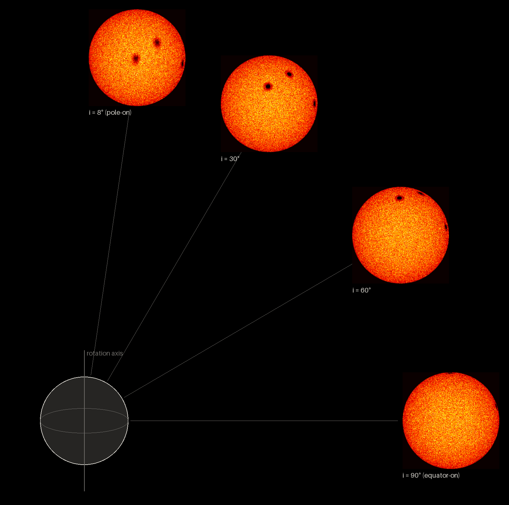
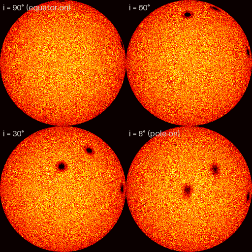
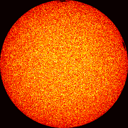
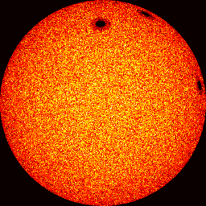
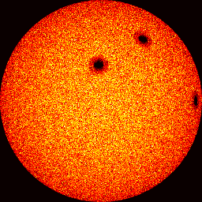
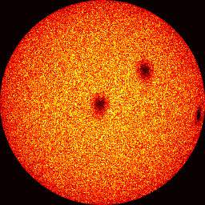

# Make: 256-f300-gpu32-snr3

2026-11-22T19:53:11 · NVIDIA GeForce RTX 5070 Laptop GPU (cc 12.0, 36 SMs) · code `72b86b63cbf7` · done

**N = 2.20e+10 photons in 2.5 s (8.8e+09 photons/s); SNR center 4.2 (predicted 4.2), limb 3.5 (predicted 3.5)**

`python main.py make --size 256 --frames 300 --snr 3 --loops 5 --yes`

## What was asked

| option | value |
|---|---|
| photons | 22004217601 |
| seed | 42 |
| limb | 1.0 |
| spots | 3 |
| observers | [1.5708, 1.0472, 0.5236, 0.0] |
| size | 256 |
| frames | 300 |
| chunk_size | 1024 |
| processor | gpu |
| precision | 32 |
| snr_at_the_limb | 3.0 |
| loops | 5 |

## Results

N = 2.2e+10, 256² pixels, 300 frames, nmu = odd nearest frames/π, observers at 1.5708, 1.0472, 0.5236, 0 rad, 3 spots

Videos: one rotation (300 frames at 30 fps), repeated 5×. All observers: [observers_around.mp4](observers_around.mp4), [observers_grid.mp4](observers_grid.mp4).

| run | photons/s | photons (s) | setup (s) | zero (s) | copy (s) | save (s) | passes | recorded | blocked |
|---|---|---|---|---|---|---|---|---|---|
| gpu32 | 8.79e+09 | 2.504 | 0.152 | 0.000 | 0.019 | 0.340 | 1 | 918633821 (4.17%) | 90705256 |

| observer | video | SNR center: measured / predicted | SNR limb ring: measured / predicted |
|---|---|---|---|
| observer_mu0047_i1.5708 | [observer_mu0047_i1.5708.mp4](observer_mu0047_i1.5708.mp4) | 4.2 / 4.2 | 3.5 / 3.5 |
| observer_mu0071_i1.0411 | [observer_mu0071_i1.0411.mp4](observer_mu0071_i1.0411.mp4) | 4.2 / 4.2 | 3.5 / 3.5 |
| observer_mu0088_i0.5293 | [observer_mu0088_i0.5293.mp4](observer_mu0088_i0.5293.mp4) | 4.2 / 4.2 | 3.5 / 3.5 |
| observer_mu0094_i0.1452 | [observer_mu0094_i0.1452.mp4](observer_mu0094_i0.1452.mp4) | 4.1 / 4.2 | 3.5 / 3.5 |

## Figures

## Files

- [`make.json`](make.json)
- [`observer_mu0047_i1.5708.mp4`](observer_mu0047_i1.5708.mp4)
- [`observer_mu0047_i1.5708_frame_0.png`](observer_mu0047_i1.5708_frame_0.png)
- [`observer_mu0071_i1.0411.mp4`](observer_mu0071_i1.0411.mp4)
- [`observer_mu0071_i1.0411_frame_0.png`](observer_mu0071_i1.0411_frame_0.png)
- [`observer_mu0088_i0.5293.mp4`](observer_mu0088_i0.5293.mp4)
- [`observer_mu0088_i0.5293_frame_0.png`](observer_mu0088_i0.5293_frame_0.png)
- [`observer_mu0094_i0.1452.mp4`](observer_mu0094_i0.1452.mp4)
- [`observer_mu0094_i0.1452_frame_0.png`](observer_mu0094_i0.1452_frame_0.png)
- [`observers/`](observers/)
- [`observers_around.mp4`](observers_around.mp4)
- [`observers_around_frame_0.png`](observers_around_frame_0.png)
- [`observers_grid.mp4`](observers_grid.mp4)
- [`observers_grid_frame_0.png`](observers_grid_frame_0.png)
- [`run.json`](run.json)
