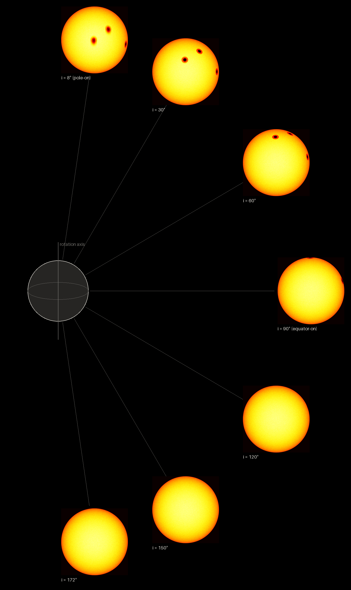
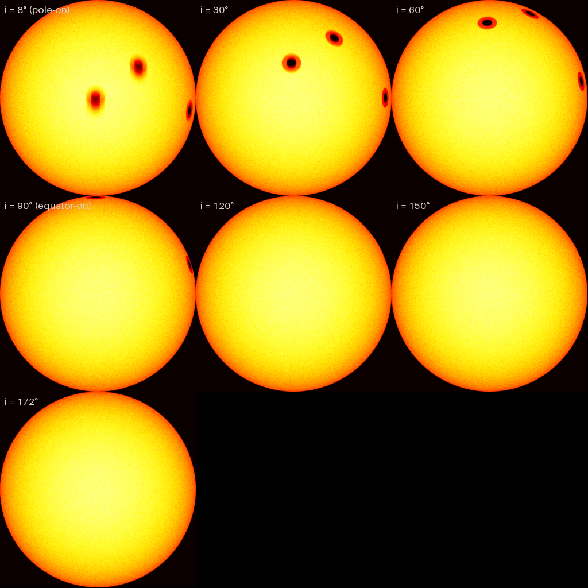
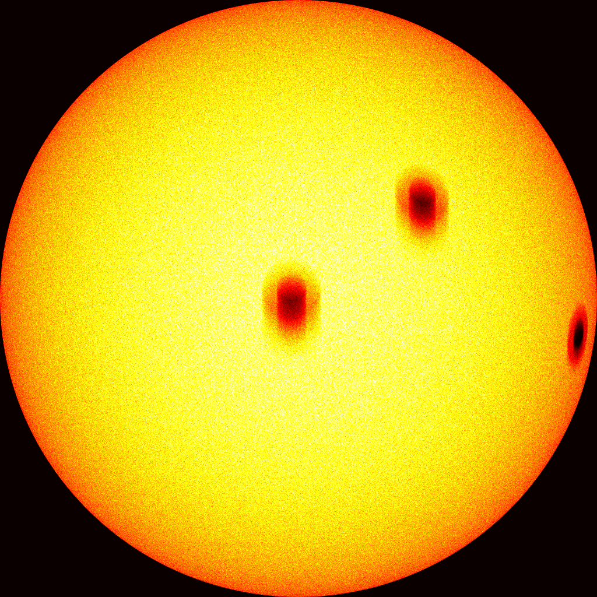
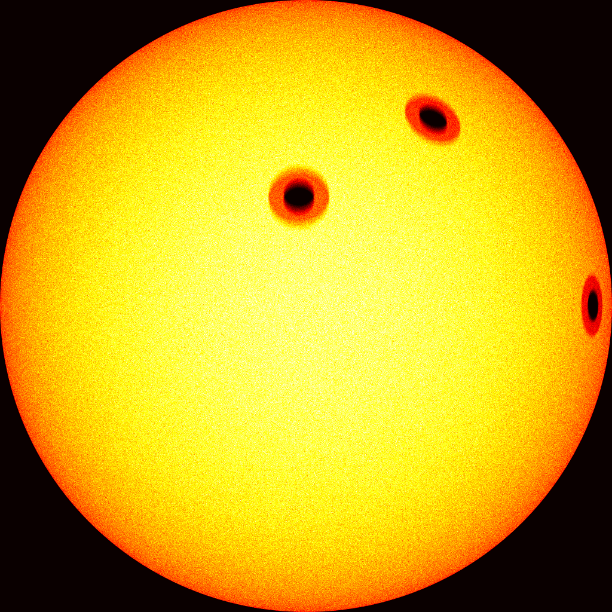
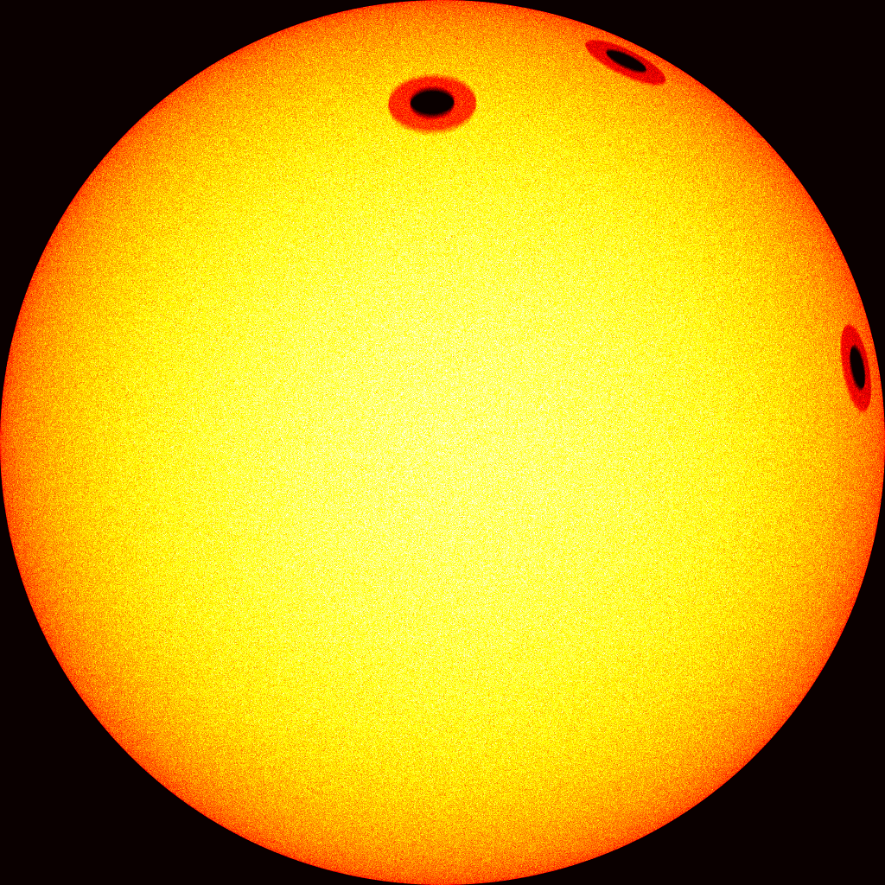
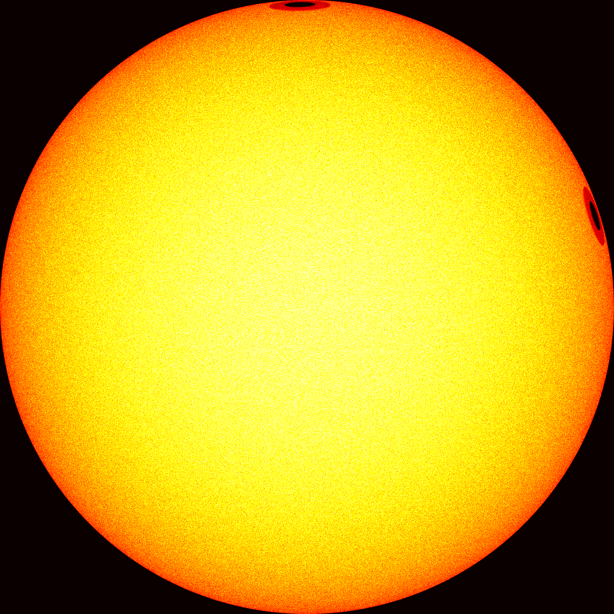
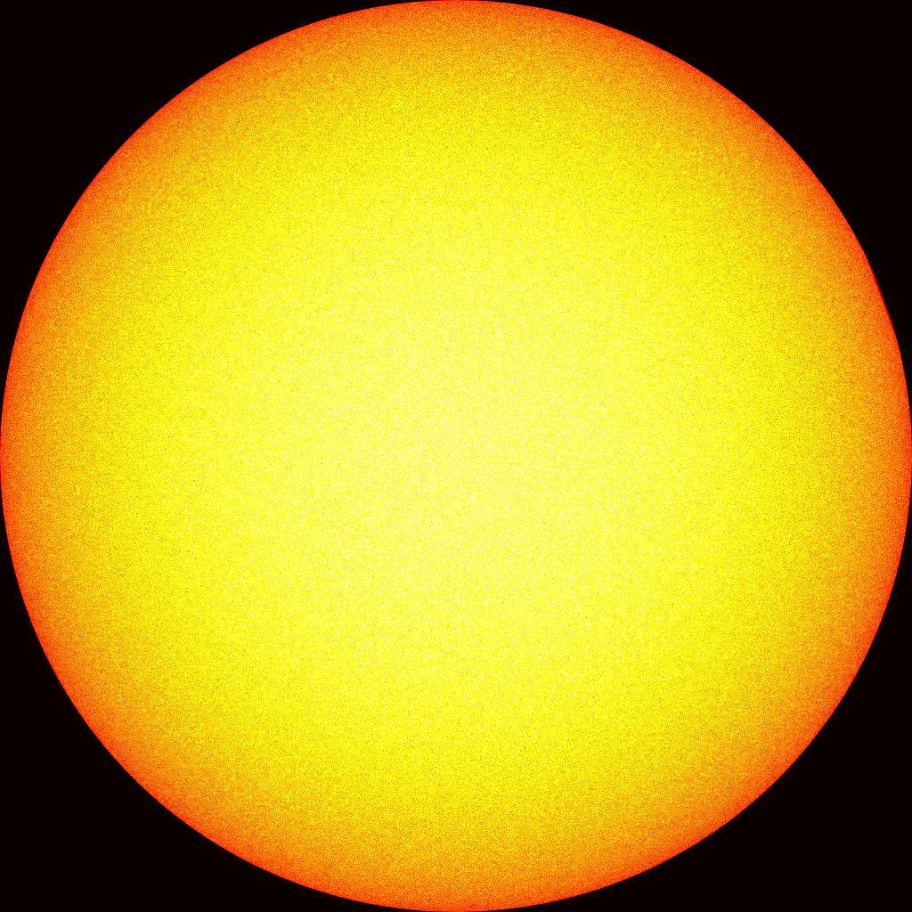
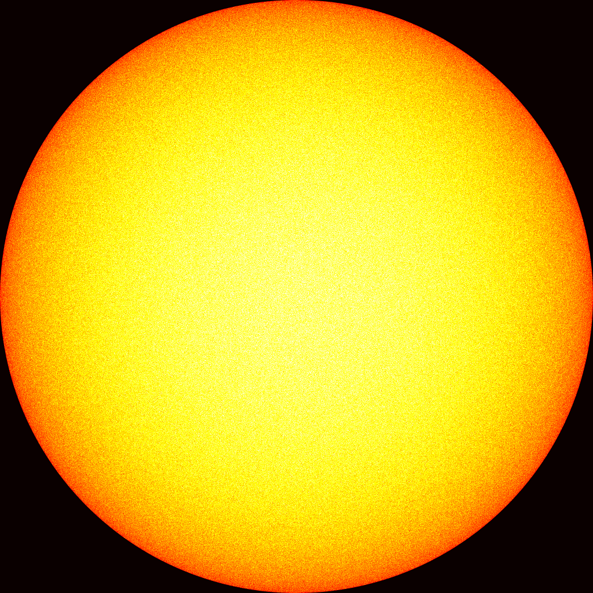
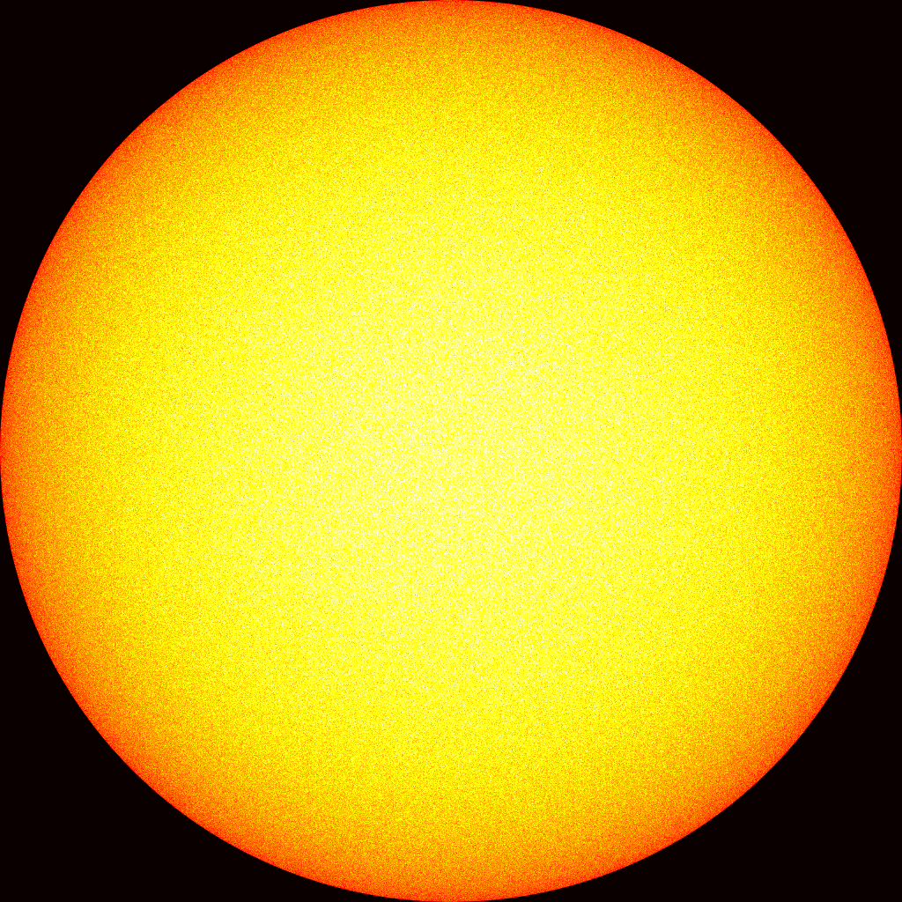

# Make: 1024-f300-gpu32-snr10

2026-11-22T20:07:02 · NVIDIA GeForce RTX 5070 Laptop GPU (cc 12.0, 36 SMs) · code `72b86b63cbf7` · done

**N = 3.91e+12 photons in 770 s (1e+10 photons/s); SNR center 14.1 (predicted 14.1), limb 11.7 (predicted 11.7)**

`python main.py make --snr 10 --yes`

## What was asked

| option | value |
|---|---|
| photons | 3911860906768 |
| seed | 42 |
| limb | 1.0 |
| spots | 3 |
| observers | [0.0, 0.5236, 1.0472, 1.5708, 2.0944, 2.618, 3.1416] |
| size | 1024 |
| frames | 300 |
| chunk_size | 1024 |
| processor | gpu |
| precision | 32 |
| snr_at_the_limb | 10.0 |
| loops | 5 |

## Results

N = 3.91e+12, 1024² pixels, 300 frames, nmu = odd nearest frames/π, observers at 0, 0.5236, 1.0472, 1.5708, 2.0944, 2.618, 3.1416 rad, 3 spots

Videos: one rotation (300 frames at 30 fps), repeated 5×. All observers: [observers_around.mp4](observers_around.mp4), [observers_grid.mp4](observers_grid.mp4).

| run | photons/s | photons (s) | setup (s) | zero (s) | copy (s) | save (s) | passes | recorded | blocked |
|---|---|---|---|---|---|---|---|---|---|
| gpu32 | 1.02e+10 | 769.508 | 0.831 | 0.000 | 0.345 | 10.039 | 2 | 286798470424 (7.33%) | 16125621967 |

| observer | video | SNR center: measured / predicted | SNR limb ring: measured / predicted |
|---|---|---|---|
| observer_mu0094_i0.1452 | [observer_mu0094_i0.1452.mp4](observer_mu0094_i0.1452.mp4) | 13.6 / 14.1 | 11.7 / 11.7 |
| observer_mu0088_i0.5293 | [observer_mu0088_i0.5293.mp4](observer_mu0088_i0.5293.mp4) | 14.0 / 14.1 | 11.7 / 11.7 |
| observer_mu0071_i1.0411 | [observer_mu0071_i1.0411.mp4](observer_mu0071_i1.0411.mp4) | 14.1 / 14.1 | 11.7 / 11.7 |
| observer_mu0047_i1.5708 | [observer_mu0047_i1.5708.mp4](observer_mu0047_i1.5708.mp4) | 14.1 / 14.1 | 11.7 / 11.7 |
| observer_mu0023_i2.1005 | [observer_mu0023_i2.1005.mp4](observer_mu0023_i2.1005.mp4) | 14.1 / 14.1 | 11.7 / 11.7 |
| observer_mu0006_i2.6123 | [observer_mu0006_i2.6123.mp4](observer_mu0006_i2.6123.mp4) | 14.1 / 14.1 | 11.7 / 11.7 |
| observer_mu0000_i2.9964 | [observer_mu0000_i2.9964.mp4](observer_mu0000_i2.9964.mp4) | 14.1 / 14.1 | 11.7 / 11.7 |

## Figures

## Files

- [`make.json`](make.json)
- [`observer_mu0000_i2.9964.mp4`](observer_mu0000_i2.9964.mp4)
- [`observer_mu0000_i2.9964_frame_0.png`](observer_mu0000_i2.9964_frame_0.png)
- [`observer_mu0006_i2.6123.mp4`](observer_mu0006_i2.6123.mp4)
- [`observer_mu0006_i2.6123_frame_0.png`](observer_mu0006_i2.6123_frame_0.png)
- [`observer_mu0023_i2.1005.mp4`](observer_mu0023_i2.1005.mp4)
- [`observer_mu0023_i2.1005_frame_0.png`](observer_mu0023_i2.1005_frame_0.png)
- [`observer_mu0047_i1.5708.mp4`](observer_mu0047_i1.5708.mp4)
- [`observer_mu0047_i1.5708_frame_0.png`](observer_mu0047_i1.5708_frame_0.png)
- [`observer_mu0071_i1.0411.mp4`](observer_mu0071_i1.0411.mp4)
- [`observer_mu0071_i1.0411_frame_0.png`](observer_mu0071_i1.0411_frame_0.png)
- [`observer_mu0088_i0.5293.mp4`](observer_mu0088_i0.5293.mp4)
- [`observer_mu0088_i0.5293_frame_0.png`](observer_mu0088_i0.5293_frame_0.png)
- [`observer_mu0094_i0.1452.mp4`](observer_mu0094_i0.1452.mp4)
- [`observer_mu0094_i0.1452_frame_0.png`](observer_mu0094_i0.1452_frame_0.png)
- [`observers/`](observers/)
- [`observers_around.mp4`](observers_around.mp4)
- [`observers_around_frame_0.png`](observers_around_frame_0.png)
- [`observers_grid.mp4`](observers_grid.mp4)
- [`observers_grid_frame_0.png`](observers_grid_frame_0.png)
- [`run.json`](run.json)
