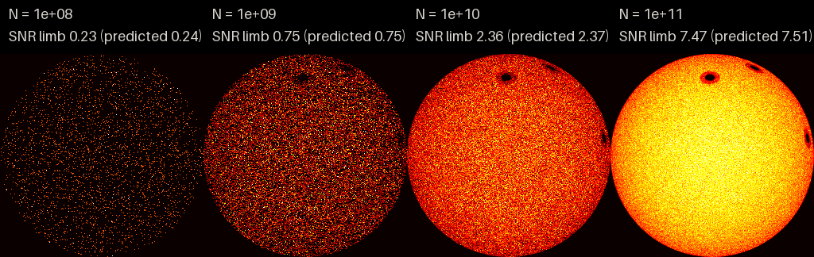
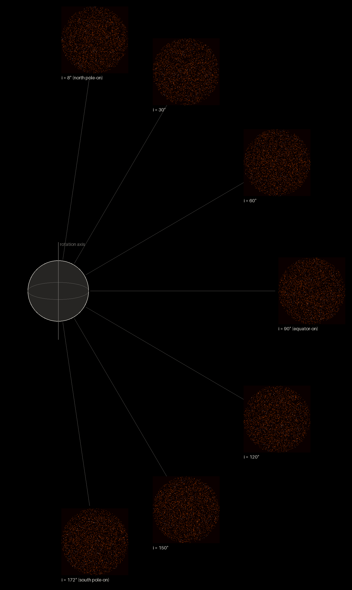
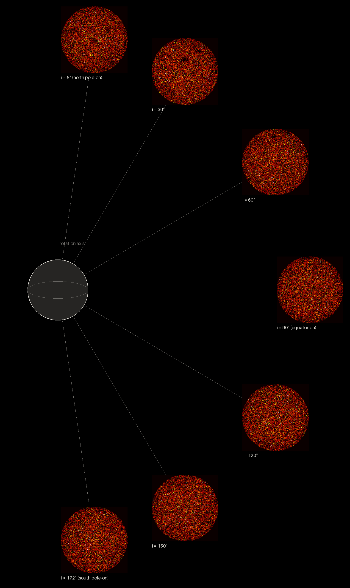
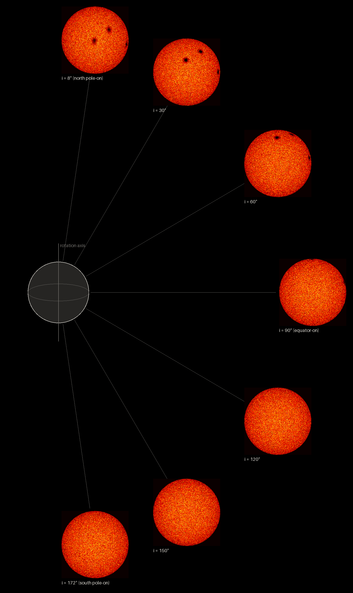
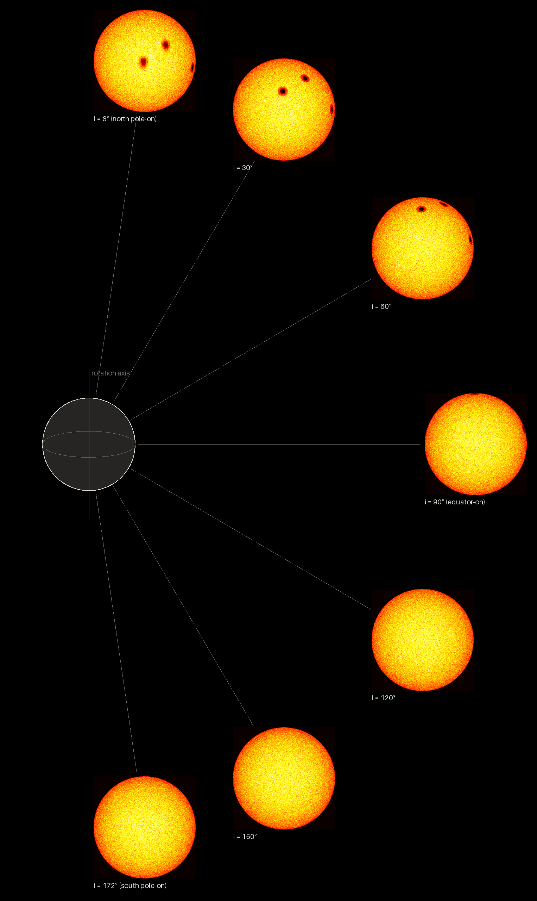

# Make: ladder-256-f300-gpu32-n1e08-n1e11

2026-11-22T20:23:46 · NVIDIA GeForce RTX 5070 Laptop GPU (cc 12.0, 36 SMs) · code `72b86b63cbf7` · done

**4 rungs, N = 1e+08 … 1e+11: SNR at the limb 0.23 … 7.5**

`python main.py make --size 256 --ladder 1e8:1e11 --loops 2 --yes`

## What was asked

| option | value |
|---|---|
| photons | 1 |
| seed | 42 |
| limb | 1.0 |
| spots | 3 |
| observers | [0.0, 0.5236, 1.0472, 1.5708, 2.0944, 2.618, 3.1416] |
| size | 256 |
| frames | 300 |
| chunk_size | 1024 |
| processor | gpu |
| precision | 32 |
| ladder | [100000000, 1000000000, 10000000000, 100000000000] |
| loops | 2 |
| ladder_inclination | 1.0472 |

## Results

N = 1, 256² pixels, 300 frames, nmu = odd nearest frames/π, observers at 0, 0.5236, 1.0472, 1.5708, 2.0944, 2.618, 3.1416 rad, 3 spots

The same star and seed at every N: each smaller run is exactly the first chunks of the larger ones, so the rungs are nested like partial sums.

| N | photons (s) | SNR limb: measured / predicted | SNR center: measured / predicted | around video |
|---|---|---|---|---|
| 1e+08 | 0.0122 | 0.23 / 0.24 | 0.29 / 0.29 | [n1e08/observers_around.mp4](n1e08/observers_around.mp4) |
| 1e+09 | 0.0963 | 0.75 / 0.75 | 0.90 / 0.90 | [n1e09/observers_around.mp4](n1e09/observers_around.mp4) |
| 1e+10 | 1.08 | 2.36 / 2.37 | 2.86 / 2.85 | [n1e10/observers_around.mp4](n1e10/observers_around.mp4) |
| 1e+11 | 15.8 | 7.47 / 7.51 | 9.02 / 9.02 | [n1e11/observers_around.mp4](n1e11/observers_around.mp4) |

The ladder: [snr_ladder.mp4](snr_ladder.mp4)

## Figures

## Files

- [`ladder.json`](ladder.json)
- [`n1e08/`](n1e08/)
- [`n1e09/`](n1e09/)
- [`n1e10/`](n1e10/)
- [`n1e11/`](n1e11/)
- [`run.json`](run.json)
- [`snr_ladder.mp4`](snr_ladder.mp4)
- [`snr_ladder_frame_0.png`](snr_ladder_frame_0.png)
