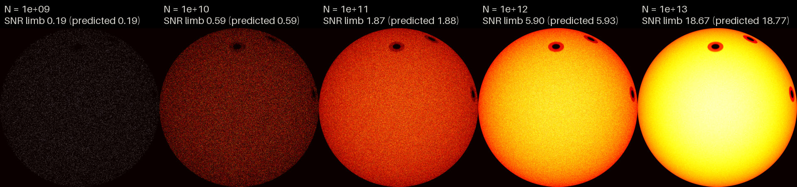
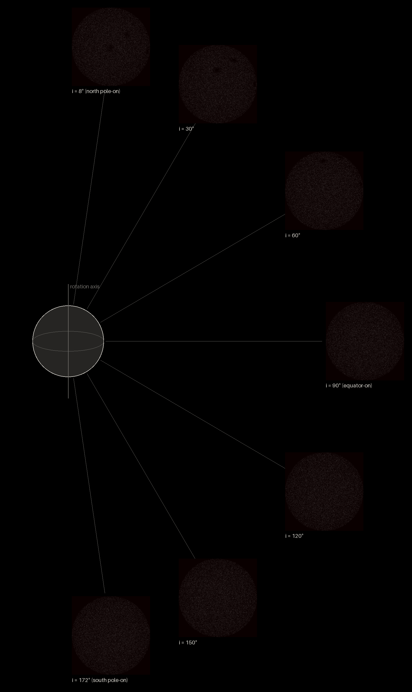
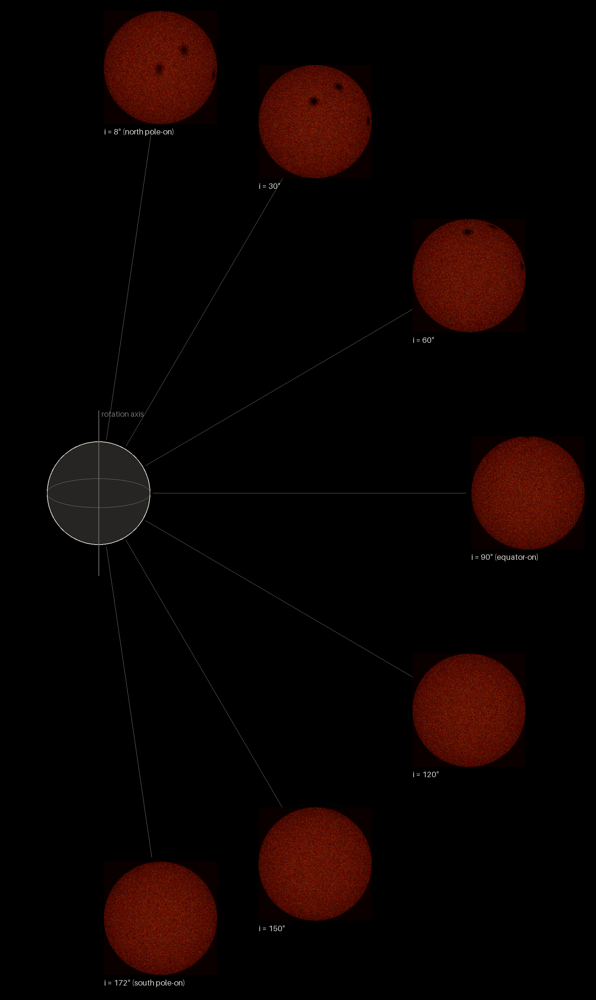
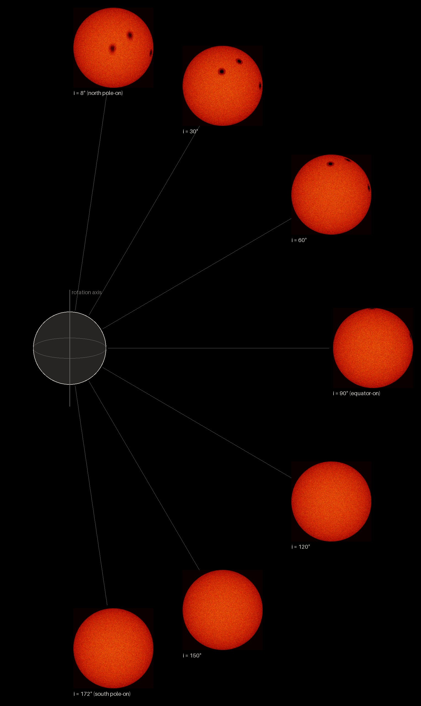
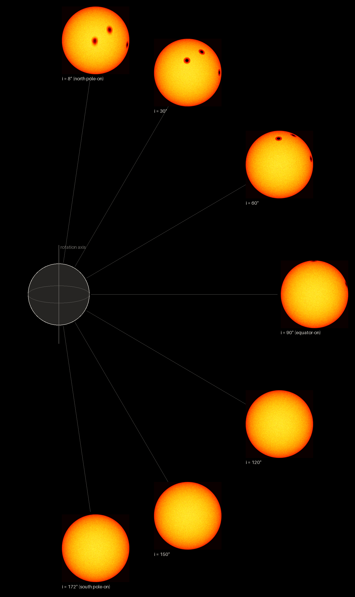
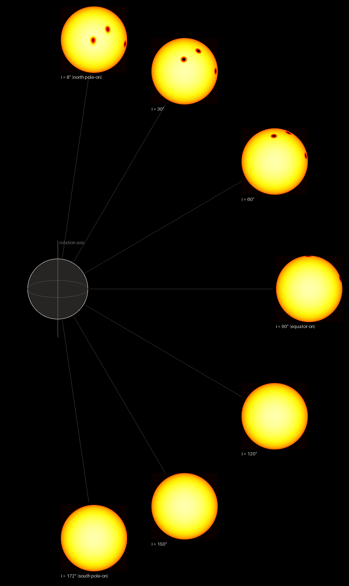

# Make: ladder-1024-f300-gpu32-n1e09-n1e13

2026-11-23T04:02:09 · NVIDIA GeForce RTX 5070 Laptop GPU (cc 12.0, 36 SMs) · code `72b86b63cbf7` · done

**5 rungs, N = 1e+09 … 1e+13: SNR at the limb 0.19 … 18.7**

`python main.py make --ladder 1e9:1e13 --size 1024 --yes`

## What was asked

| option | value |
|---|---|
| photons | 1 |
| seed | 42 |
| limb | 1.0 |
| spots | 3 |
| observers | [0.0, 0.5236, 1.0472, 1.5708, 2.0944, 2.618, 3.1416] |
| size | 1024 |
| frames | 300 |
| chunk_size | 1024 |
| processor | gpu |
| precision | 32 |
| ladder | [1000000000, 10000000000, 100000000000, 1000000000000, 10000000000000] |
| loops | 5 |
| ladder_inclination | 1.0472 |

## Results

N = 1, 1024² pixels, 300 frames, nmu = odd nearest frames/π, observers at 0, 0.5236, 1.0472, 1.5708, 2.0944, 2.618, 3.1416 rad, 3 spots

The same star and seed at every N: each smaller run is exactly the first chunks of the larger ones, so the rungs are nested like partial sums.

| N | photons (s) | SNR limb: measured / predicted | SNR center: measured / predicted | around video |
|---|---|---|---|---|
| 1e+09 | 0.197 | 0.19 / 0.19 | 0.23 / 0.23 | [n1e09/observers_around.mp4](n1e09/observers_around.mp4) |
| 1e+10 | 1.76 | 0.59 / 0.59 | 0.71 / 0.71 | [n1e10/observers_around.mp4](n1e10/observers_around.mp4) |
| 1e+11 | 17.7 | 1.87 / 1.88 | 2.26 / 2.26 | [n1e11/observers_around.mp4](n1e11/observers_around.mp4) |
| 1e+12 | 182 | 5.90 / 5.93 | 7.13 / 7.13 | [n1e12/observers_around.mp4](n1e12/observers_around.mp4) |
| 1e+13 | 1.87e+03 | 18.67 / 18.77 | 22.54 / 22.55 | [n1e13/observers_around.mp4](n1e13/observers_around.mp4) |

The ladder: [snr_ladder.mp4](snr_ladder.mp4)

## Figures

## Files

- [`ladder.json`](ladder.json)
- [`n1e09/`](n1e09/)
- [`n1e10/`](n1e10/)
- [`n1e11/`](n1e11/)
- [`n1e12/`](n1e12/)
- [`n1e13/`](n1e13/)
- [`run.json`](run.json)
- [`snr_ladder.mp4`](snr_ladder.mp4)
- [`snr_ladder_frame_0.png`](snr_ladder_frame_0.png)
