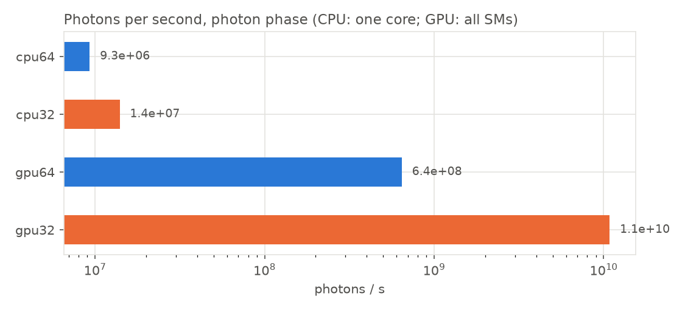

# Measure: Welton-validation-devices-kernel

2026-11-22T17:06:33 · NVIDIA GeForce RTX 5070 Laptop GPU (cc 12.0, 36 SMs); Intel(R) Core(TM) Ultra 7 255HX (one core) · code `72b86b63cbf7` · passed

**GPU 6.4e+08/s FP64 (69× one core), 1.1e+10/s FP32; validation passed**

`python main.py measure --parts validation,devices,kernel --seconds 0.3 --repeats 1 --allow-invalid --yes`

## What was asked

| option | value |
|---|---|
| parts | ['validation', 'devices', 'kernel'] |
| seconds | 0.3 |
| repeats | 1 |
| targets | ['80'] |
| allow_invalid | True |
| photons | {'cpu64': 8000000, 'cpu32': 15000000, 'gpu64': 1000000000, 'gpu32': 15000000000} |

## Results

**The report:** [report.pdf](report.pdf) and [report.ipynb](report.ipynb) (the same, with the code that reads the data).

- `validation`: [`parts/validation.json`](parts/validation.json)
- `devices`: [`parts/devices.json`](parts/devices.json)
- `kernel`: [`parts/kernel.json`](parts/kernel.json)

## Figures

## Files

- [`figures/`](figures/)
- [`machine.json`](machine.json)
- [`parts/`](parts/)
- [`plan.json`](plan.json)
- [`points/`](points/)
- [`progress.log`](progress.log)
- [`report.ipynb`](report.ipynb)
- [`report.pdf`](report.pdf)
- [`run.json`](run.json)
- [`validation/`](validation/)
