# Measure: Welton-all

2026-11-22T20:25:24 · NVIDIA GeForce RTX 5070 Laptop GPU (cc 12.0, 36 SMs); Intel(R) Core(TM) Ultra 7 255HX (the sequential reference) · code `72b86b63cbf7` · passed

**GPU 6.7e+08/s FP64 (36.3× one SM), 1.1e+10/s FP32 (35.3× one SM); strong FP64 36.3× on 36 SMs; FP64 fastest at 72 registers (occupancy 0.58); validation passed**

`python main.py measure --yes`

## What was asked

| option | value |
|---|---|
| parts | ['validation', 'speed', 'kernel', 'occupancy', 'scaling', 'costs'] |
| seconds | 5.0 |
| repeats | 3 |
| targets | ['80'] |
| allow_invalid | False |
| photons | {'gpu64': 4000000000, 'gpu32': 50000000000} |
| star | {'size': 1024, 'frames': 300} |

## Results

**The report:** [report.pdf](report.pdf) and [report.ipynb](report.ipynb) (the same, with the code that reads the data).

- `validation`: [`parts/validation.json`](parts/validation.json)
- `speed`: [`parts/speed.json`](parts/speed.json)
- `kernel`: [`parts/kernel.json`](parts/kernel.json)
- `occupancy`: [`parts/occupancy.json`](parts/occupancy.json)
- `scaling`: [`parts/scaling.json`](parts/scaling.json)
- `costs`: [`parts/costs.json`](parts/costs.json)

## Figures

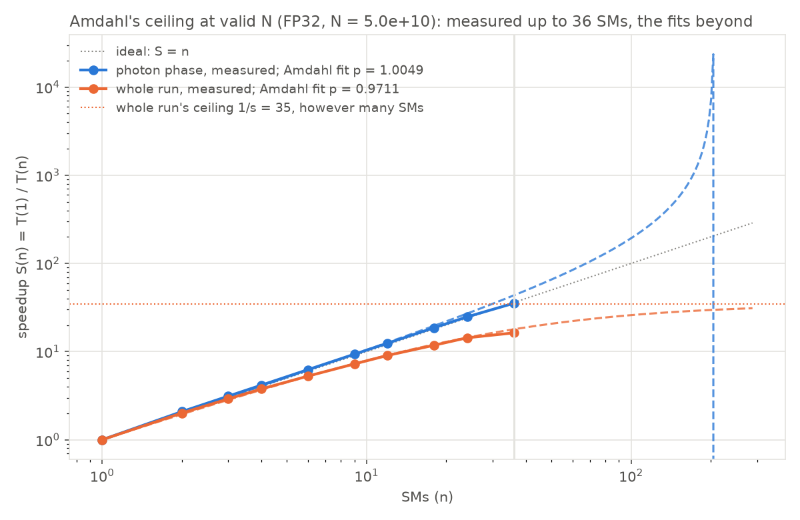
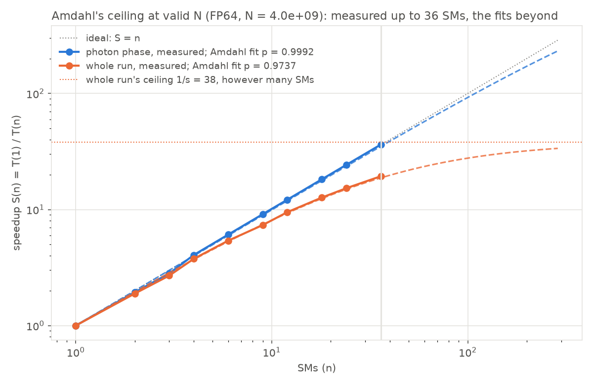
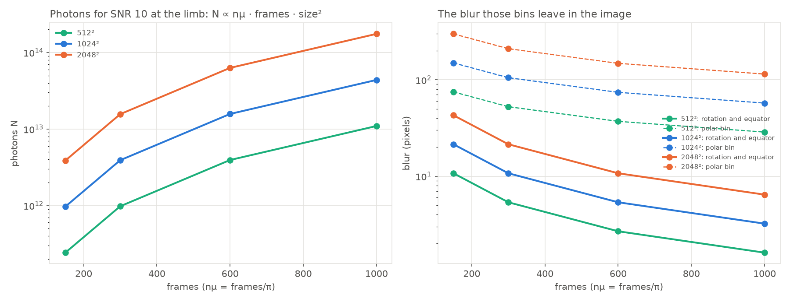
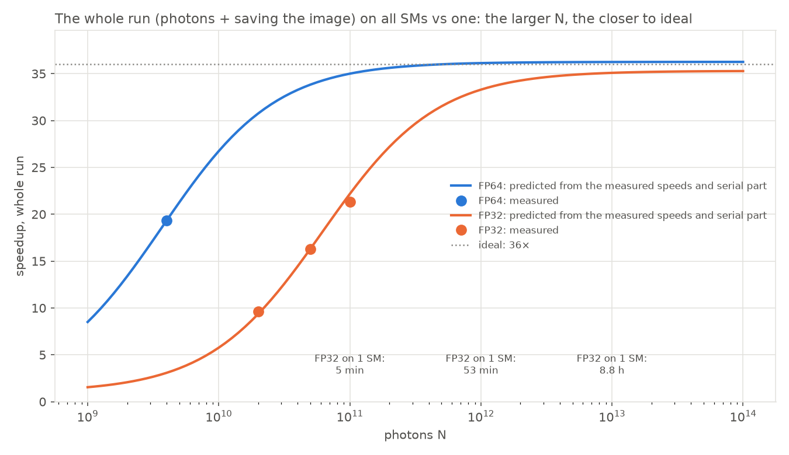
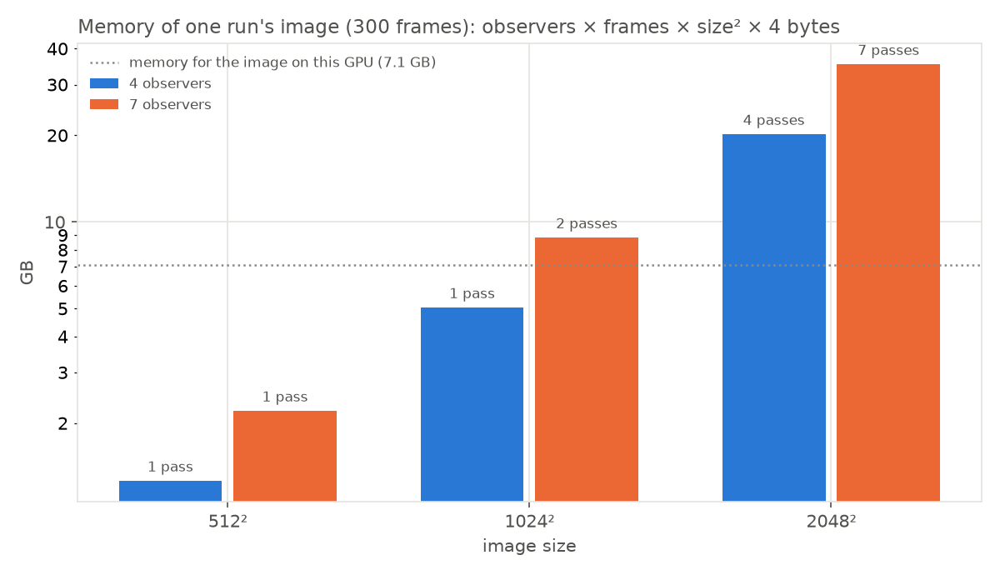
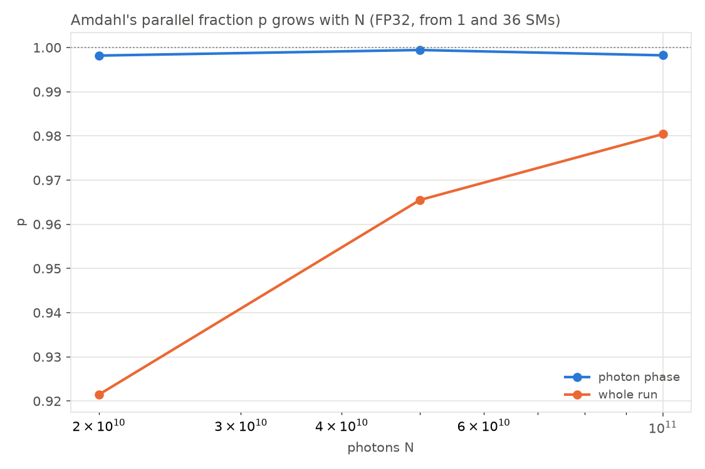
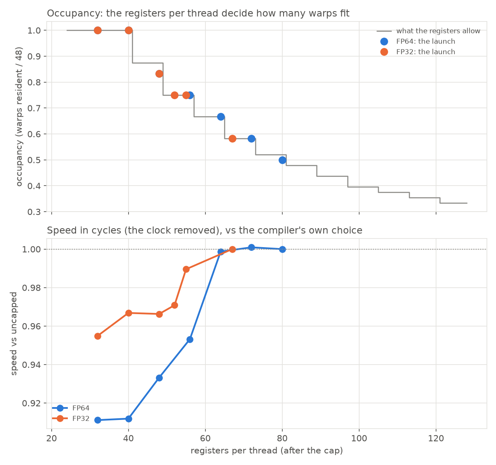
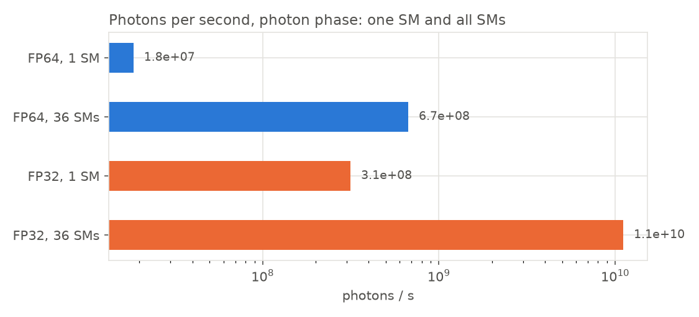
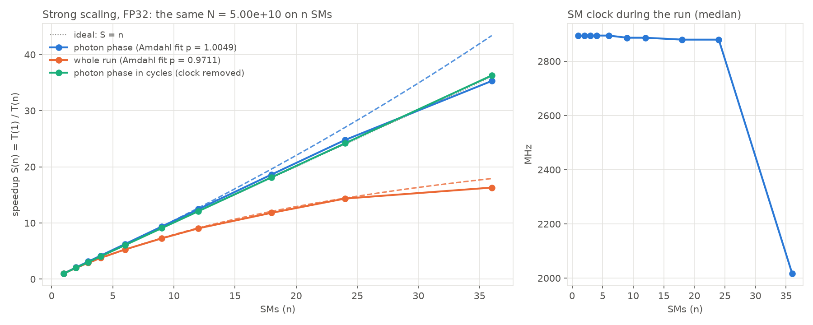
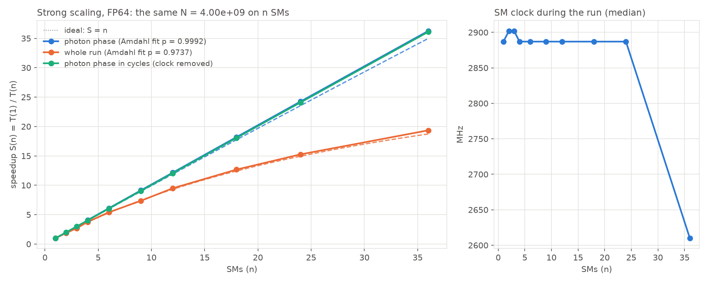
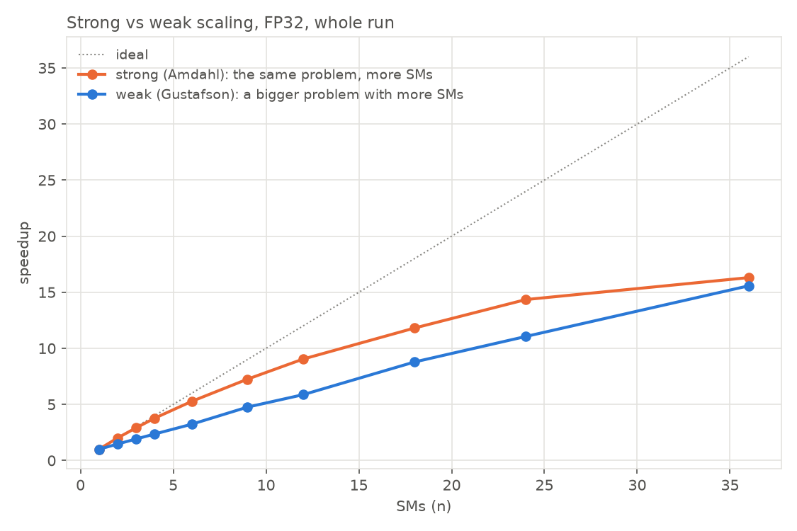
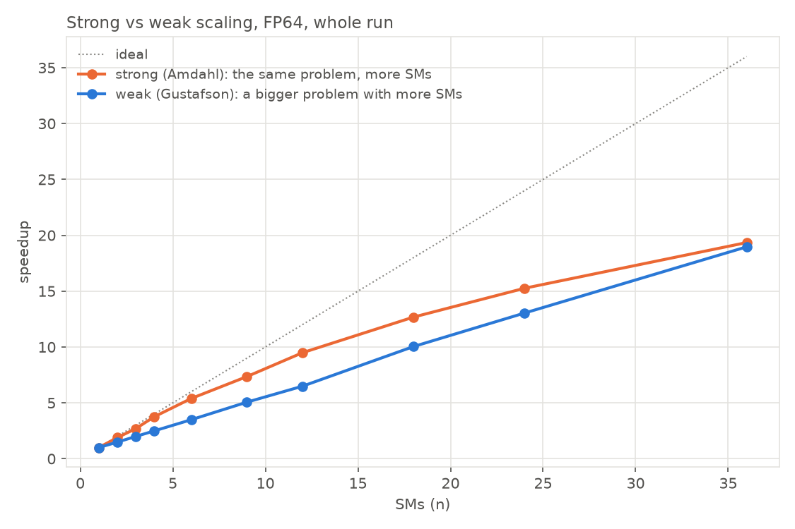
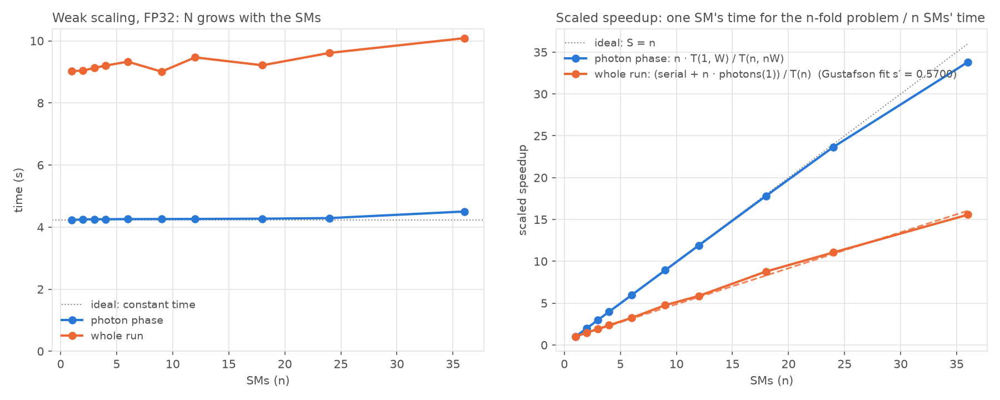
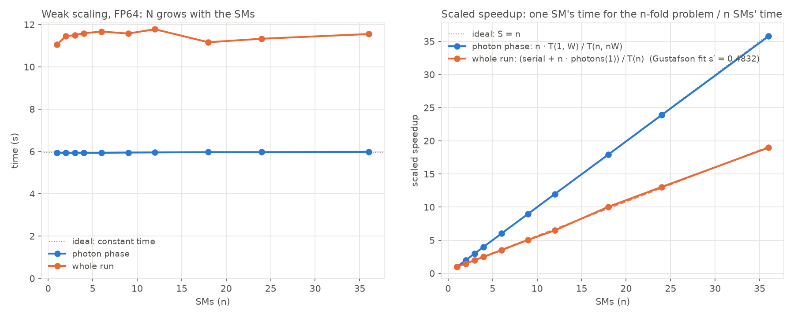

## Files

- [`figures/`](figures/)
- [`machine.json`](machine.json)
- [`parts/`](parts/)
- [`plan.json`](plan.json)
- [`points/`](points/)
- [`progress.log`](progress.log)
- [`report.ipynb`](report.ipynb)
- [`report.pdf`](report.pdf)
- [`run.json`](run.json)
- [`summary.md`](summary.md)
- [`validation/`](validation/)
