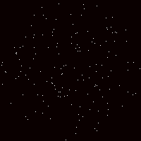
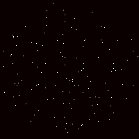
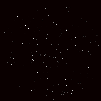
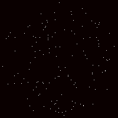

# Star: gpu64

2026-11-22T11:28:57 · NVIDIA GeForce RTX 5070 Laptop GPU (cc 12.0, 36 SMs) · code `72b86b63cbf7` · done

**1e+06 photons in 0.010 s (9.63e+07 photons/s)**

`python main.py star -n 1e6 --processor gpu`

## What was asked

| option | value |
|---|---|
| photons | 1000000 |
| seed | 42 |
| limb | 1.0 |
| spots | 3 |
| observers | [1.5708, 1.0472, 0.5236, 0.0] |
| size | 200 |
| frames | 150 |
| chunk_size | 1024 |
| processor | gpu |
| precision | 64 |

## Results

N = 1e+06, 200² pixels, 150 frames, nmu = odd nearest frames/π, observers at 1.5708, 1.0472, 0.5236, 0 rad, 3 spots

| run | photons/s | photons (s) | setup (s) | zero (s) | copy (s) | save (s) | passes | recorded | blocked |
|---|---|---|---|---|---|---|---|---|---|
| gpu64 | 9.63e+07 | 0.010 | 0.210 | 0.000 | 0.007 | 0.138 | 1 | 84337 (8.43%) | 4118 |

## Figures

## Files

- [`observer_mu0023_i1.5708.gif`](observer_mu0023_i1.5708.gif)
- [`observer_mu0023_i1.5708_frame_0.png`](observer_mu0023_i1.5708_frame_0.png)
- [`observer_mu0035_i1.0349.gif`](observer_mu0035_i1.0349.gif)
- [`observer_mu0035_i1.0349_frame_0.png`](observer_mu0035_i1.0349_frame_0.png)
- [`observer_mu0043_i0.5528.gif`](observer_mu0043_i0.5528.gif)
- [`observer_mu0043_i0.5528_frame_0.png`](observer_mu0043_i0.5528_frame_0.png)
- [`observer_mu0046_i0.2067.gif`](observer_mu0046_i0.2067.gif)
- [`observer_mu0046_i0.2067_frame_0.png`](observer_mu0046_i0.2067_frame_0.png)
- [`observers/`](observers/)
- [`result.json`](result.json)
- [`run.json`](run.json)
