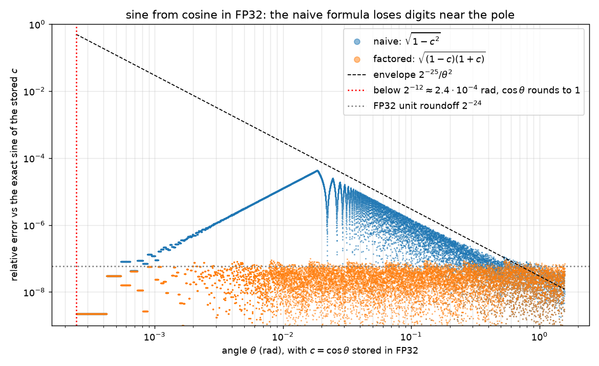

# Floating-point precision: FP64, FP32, FP16 and random bits

Do we need FP64 for the star? Short answer: **probably not**. This file explains why, and what EP4 does to measure it instead of assuming it.

## 1. The formats

IEEE 754 stores a number as sign × mantissa × 2^exponent. A `double` has 64 bits: 1 sign, 11 exponent and 52 stored mantissa bits, plus an implicit leading 1, so **53 bits of precision**.

| Format | Precision bits | Unit roundoff (relative error of one operation) | Decimal digits | Largest value |
|---|---|---|---|---|
| FP64 `double` | 53 | 2⁻⁵³ ≈ 1.1·10⁻¹⁶ | ~16 | ~1.8·10³⁰⁸ |
| FP32 `float` | 24 | 2⁻²⁴ ≈ 6.0·10⁻⁸ | ~7 | ~3.4·10³⁸ |
| FP16 `half` | 11 | 2⁻¹¹ ≈ 4.9·10⁻⁴ | ~3 | 65 504 |

## 2. Random bits are not the same as the type

A uniform random number is built from random **bits**. The number of random bits sets how fine its grid is, whatever type stores it.

- **53 random bits:** ξ = k·2⁻⁵³, about 9·10¹⁵ equally spaced values in [0,1). That is the full precision of a double.
- **32 random bits:** ξ = k·2⁻³² + offset, about 4.3·10⁹ values spaced 2.3·10⁻¹⁰.

What cuRAND does with Philox (read from `curand_uniform.h`, `curand_globals.h`, CUDA 13.3):

| Function | Bits used | Formula | Interval |
|---|---|---|---|
| `curand_uniform` (float) | 32 (one draw) | `x * 2^-32 + 2^-33` | (0, 1] |
| `curand_uniform_double` | **32 (one draw)** | `x * 2^-32 + 2^-32` | (0, 1] |
| `curand_uniform2_double` | 53 (two draws per double) | `(x ^ (y << 21)) * 2^-53 + 2^-54` | (0, 1) |

So `curand_uniform_double` returns a double that only carries 32 bits of randomness.

### Does the star need more than 32 random bits?

Compare the grid with the **smallest physical scale** in the problem:

- a pixel: 1/512 ≈ 2·10⁻³ (HD);
- an observer bin: 2/nmu ≈ 10⁻², and 2π/nphi;
- a spot radius: 0.05 rad.

All are millions of times coarser than 2.3·10⁻¹⁰. Each photon also combines 5–6 independent draws, so even with 10¹² photons (each 32-bit value drawn ~250 times) the positions are only quantized at ~10⁻¹⁰, far below a pixel. **32 bits are enough.** 53 bits would only matter for quantities that are very sensitive to tiny ξ, such as `log(ξ)` in exponential sampling, which the star does not use.

**EP4 decision:** use cuRAND's standard 32-bit uniforms (`curand_uniform_double` for FP64, `curand_uniform` for FP32), and the same conversion in the CPU copy.

## 3. Why Monte Carlo is forgiving

Each photon is a short, independent calculation (~50 operations), and the tally is an **integer** count. Rounding errors do not build up from photon to photon, as they would in a long time integration, and there is no need for Kahan summation. What matters is only the error inside one photon, and whether it introduces a **bias**.

## 4. Where precision actually bites

1. **Bias at pixel edges.**
   - An FP32 relative error of ~6·10⁻⁸ only moves photons that land within ~10⁻⁷ of a pixel edge, about 10⁻⁵ of them.
   - The effect on the image is ~10⁻⁵. Poisson noise at 100 counts is 10%, and detecting a 10⁻⁵ bias would need ~10¹⁰ counts per pixel.
   - **Invisible.**
2. **Cancellation near the poles.** (Measured in section 8.)
   - `sqrt(1 - z*z)` subtracts two nearly equal numbers when z → 1. In FP32, the radius near the pole is resolved to ~3·10⁻⁴, a tiny artifact still below a pixel.
   - Fix: `sqrt((1 - z) * (1 + z))`, which keeps the small difference exact.
   - The same applies to the professor's `raiz = sqrt(1 - w*w)` for observers near the poles, and to `sin θ = sqrt(1 - μ²)`.
3. **Small spots.**
   - `cos_angle > cos(radius)` compares numbers close to 1. In FP32, the spot edge is resolved to ~6·10⁻⁸ / sin r. That is about 10⁻⁶ rad for r = 0.05 (fine), but **about 6% of the radius for r = 10⁻³**.
   - The precision needed depends on the smallest physical scale.
   - Fix: compare the squared chord instead, |p − s|² < 2(1 − cos r) = 4 sin²(r/2). The difference p − s of two nearby unit vectors is computed accurately.
4. **Why EP3's FP32 hit a floor.**
   - Buffon estimates π from the *ratio* of crossings, and the FP32 comparison `x <= L/2·sinf(θ)` has a systematic bias of ~10⁻⁷.
   - Once the statistical error falls below the bias (around 7 digits), more needles do not help.
   - That was a bias, not accumulated rounding. The star only needs SNR ~10–30 per pixel, so it never gets near such a floor.
5. **FP16 cannot work here.**
   - Its spacing near 1 is ~10⁻³, which cannot even place a photon inside a 512-pixel image (pixel = 2·10⁻³).
   - It also cannot hold counts above 65 504.

## 5. What precision costs on this GPU

- **The FP64 rate.** The RTX 5070 Laptop runs FP64 at 1/64 of the FP32 rate. **[measured: the CUDA attribute in EP3]** EP3 measured a 16× gap between FP64 and FP32 Buffon, not 64×, because Buffon also spends time on integer work (RNG, loop, atomics).
- **FP64 math functions.** The star uses more floating-point work (sin, cos, sqrt, cbrt, atan2), and an FP64 `sin` is a software sequence of many FP64 operations, so the gap may be closer to 64×. **[prediction, to measure]**
- **Registers.** A double takes two registers, which can lower occupancy.

## 6. What EP4 does

1. **A `real` type**, `double` by default, `float` when compiled with `-DSTAR_FP32` (`engine/real.cuh`). The physics is written once and works for both.
2. **FP64 on the CPU is the reference.**
3. **FP32-friendly formulas from the start:** `(1 - z)(1 + z)` under square roots, and the squared chord for spots.
4. **Experiment:** FP32 vs FP64 at the same seed and N, a per-pixel χ² (expected ≈ 1: no difference beyond noise), and the speed ratio. This is a TCD section: *the physical scales say FP32 is enough, and here is the measurement*.

## 7. First measurement (CPU, N = 10⁸, EP2's default star) **[measured]**

`python star.py -n 1e8 --compare-precision` (today: the precision check in `python main.py measure --parts validation`):

- **Same random numbers, same photons.** Recorded photons: 2 652 017 in both. Photons in spots: 411 940 (FP64) vs 411 941 (FP32), one photon at a spot edge.
- **5·10⁻⁴ of the recorded photons land in a different pixel or bin** in FP32. That is larger than the rough 10⁻⁵ guessed in section 4. The rounding inside a photon (trig of angles up to 2π, several chained operations) is closer to 10⁻⁶ than to one unit roundoff, and every photon crosses four binnings (ix, iy, imu, iphi).
- **Still far below the noise.**
  - The relative Poisson noise per lit pixel (frames summed) is 0.22.
  - Two FP64 runs with different seeds (noise alone) give χ²/dof = 1.0007.
  - Rounding moves 5·10⁻⁴ of the photons: hundreds of times below the noise.
- **Speed on one CPU core:** FP32 is about 1.6× faster than FP64.

## 8. Deep dive: `sine_from_cosine` and the FP32 correction

```c
static inline HD real sine_from_cosine(real cosine) {
    real sine_squared = (1 - cosine) * (1 + cosine);
    return sine_squared > 0 ? real_sqrt(sine_squared) : 0;
}
```

The textbook formula is `sqrt(1 - c*c)`. EP4 computes `sqrt((1 - c)(1 + c))` instead. Algebraically they are the same; in floating point they are not.

### 8.1 Where the star uses it

| Call | Cosine | Sine | Is the cosine exact? |
|---|---|---|---|
| `sample_surface_point` | z of the point (sampled) | radius of its ring, r = √(1 − z²) | yes: z *is* the sample |
| `sample_emission_direction` | μ of the emission (sampled) | sin θ of the emission | yes: μ *is* the sample |
| `pixel_index` | w = direction.z (computed) | the professor's `raiz` | no: w carries the rounding of the direction formula |

All three are "the sine, given the cosine", which is where the name comes from.

### 8.2 Why the naive formula loses digits

Let c be stored in FP32 (unit roundoff u = 2⁻²⁴ ≈ 6·10⁻⁸) and θ small, so c is close to 1.

- **Naive, `1 - c*c`.**
  - `c*c` is rounded: an absolute error up to ~u.
  - `1 - c*c` subtracts two nearly equal numbers. The subtraction itself is exact, but it keeps the error of `c*c`, while the result is small: 1 − c² ≈ θ².
  - So the relative error of 1 − c² grows like u/θ², and that of the sine like **u/(2θ²)**.
  - This is called **catastrophic cancellation**: the leading digits cancel, and the rounding error of the previous step becomes the leading digit of the result.
- **Factored, `(1 - c)(1 + c)`.**
  - `1 - c` is **exact** for c in [½, 1] (Sterbenz's lemma: the difference of two floats within a factor of 2 of each other is representable).
  - `1 + c` and the product are each rounded once, with a relative error of at most u, and so is the square root.
  - Result: **a relative error of a few u, at every angle.** Nothing small is subtracted after a rounding.

### 8.3 Measured

`python docs/experiments/sine_from_cosine.py` compares both formulas, in FP32, with the exact sine of the same stored FP32 cosine (computed in FP64):

| θ (rad) | c in FP32 | naive | factored |
|---|---|---|---|
| 10⁻³ | 0.999999523 | 1.2·10⁻⁷ | 7·10⁻¹⁵ |
| 10⁻² | 0.999949992 | **1.3·10⁻⁵** | 1.6·10⁻⁸ |
| 0.05 | 0.998750269 | 2.4·10⁻⁶ | 2.1·10⁻⁸ |
| 0.1 | 0.995004177 | 7.9·10⁻⁷ | 4.1·10⁻⁸ |
| 0.5 | 0.877582550 | 2.3·10⁻⁸ | 2.3·10⁻⁸ |
| 1 | 0.540302277 | 1.5·10⁻⁸ | 1.5·10⁻⁸ |

**Worst case** over the 65 536 floats just below 1: **naive 4.3·10⁻⁵, factored 1.0·10⁻⁷**, about 400 times better.



The shape of the naive curve is worth explaining in the class:

- **Above θ ≈ 0.02 rad**, the error follows the envelope u/(2θ²): the cancellation analysis above.
- **The worst point is near θ ≈ 0.018 rad (about 1°), not at the pole.**
  - Very close to 1, the floats are 1 − k·2⁻²⁴ for small whole numbers k.
  - Their squares are 1 − 2k·2⁻²⁴ + k²·2⁻⁴⁸. Rounding only drops the tiny k²·2⁻⁴⁸ term, so the error grows with k, linearly in θ on the log plot.
  - The two regimes meet at k ≈ 2 900, θ ≈ 0.018.
- **On the left**, both formulas reach the limit of the cosine itself (8.4).

### 8.4 What the factored form cannot fix

1. **The cosine has to carry the angle.**
   - In FP32, cos θ rounds to exactly 1 for θ < 2⁻¹² ≈ 2.4·10⁻⁴ rad. There the sine comes out 0 whatever the formula.
   - Just above, the stored cosines are 1 − 2⁻²⁴, 1 − 2·2⁻²⁴, ..., so the smallest nonzero sine is √(2·2⁻²⁴) ≈ 3.5·10⁻⁴: **angles near the pole come in steps**.
   - The factored form gives the exact sine *of the stored cosine*; it cannot bring back what was lost when the cosine was rounded.
2. **Errors already in the cosine.**
   - If c carries an error δ (as w does, coming out of the direction formula), the sine moves by δ·cos θ / sin θ ≈ δ/θ.
   - That is a relative error δ/θ², amplified near the pole by the same 1/θ², no matter how the sine is computed.
   - The fix only removes the rounding of the formula itself, so it fully helps for z and μ (exact samples) and only partly for w.

### 8.5 Inside the star: does it matter?

Same 10⁸ photons (seed 42, EP2's default star), FP64 as reference. Fraction of recorded photons that land in a different pixel or bin:

| FP32 build | all | observer 0 (pole) | observer 1 | observer 2 | observer 3 (pole) |
|---|---|---|---|---|---|
| factored (EP4) | 5.01·10⁻⁴ | 9.6·10⁻⁴ | 3.0·10⁻⁵ | 4.5·10⁻⁵ | 9.7·10⁻⁴ |
| naive `1 - c*c` | 5.04·10⁻⁴ | 9.5·10⁻⁴ | 2.9·10⁻⁵ | 4.5·10⁻⁵ | 9.9·10⁻⁴ |

The naive variant was built from a copy of the engine with only that line changed.

- **In the star the two formulas are practically the same.** The 1° worst case of the naive formula falls on too few photons, and its 10⁻⁵ error is far smaller than a pixel.
- **The rounding differences concentrate on the pole observers, about 30 times more.**
  - Observers 0 and 3 sit in the μ bins at the poles (imu = 0 and 149, within ~9° of the axis).
  - Splitting the differences shows they are **changes of pixel, not of frame**: 9.3·10⁻⁴ of observer 0's photons change pixel, only 3·10⁻⁵ change frame.
- **The cause is the projection.**
  - Near the pole, `pixel_index` divides u and v by `raiz` = sin θ_w, which is small (≤ 0.16 in those bins).
  - It is itself computed from the rounded direction, so the rounding of the direction formula is amplified (8.4, item 2).
  - In geometry: looking down the pole, the image's orientation depends on the azimuth of the line of sight, which is ill-defined there (a coordinate singularity). FP32 rounding turns the image by a tiny angle, and pixels near the edge flip.
- **Still far below the noise.** 10⁻³ of photons moved, against 22% Poisson noise per lit pixel at this N.

### 8.6 Lessons

1. **Rewrite cancellations when it is free.** `(1 − c)(1 + c)` costs the same as `1 − c²`, is never worse, and is ~400 times better in the worst case. EP4 keeps it.
2. **Precision is a property of the whole calculation, not of one formula.** The real FP32 sensitivity of the star is at the pole observers, where the projection is ill-conditioned, not in the sine.
3. **Coordinate singularities are where low precision hurts.** Poles, azimuths of nearly vertical vectors, divisions by sin θ. They are where to look first.
4. **Measure before fixing.** The analysis predicted a large gain; the star shows almost none, and pointed to the real hot spot instead. If the pole observers ever needed better FP32 accuracy, the fix would be in the projection (for example, normalizing (u, v) with `hypot` instead of dividing by `raiz`), not in the sine.

To reproduce: `python docs/experiments/sine_from_cosine.py` (table and figure). The star experiment builds a copy of `EP4/engine` with `sine_squared = 1 - cosine * cosine` and compares `star32` with `star` on the same photons. The GPU gap is still to be measured (prediction: much larger, up to the 64× hardware ratio).
